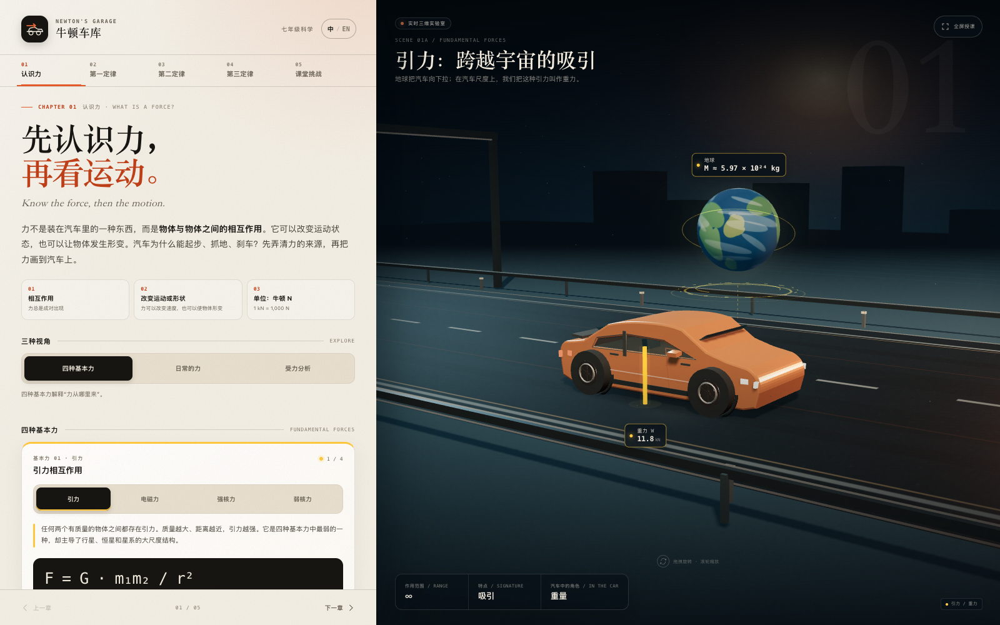

# 牛顿车库 · Newton's Garage（认识力版）

> 在原项目副本上扩展的七年级科学 3D 双语课程。原 `newton-motion-lab/` 未修改，本版本位于 `newton-motion-lab-v2/`。
>
> Grade 7 Science · Forces & Motion. This expanded edition adds “What is a force?” to the original car-based lesson.



## 本次新增了什么

- **第一章节更名**：章节导航由“受力”改为“**认识力**”，章节编号和 `#forces` 独立链接保持不变。
- **新知识点**
  - 四种基本力：引力、电磁力、强核力、弱核力；
  - 日常常见的力：重力、摩擦力、空气阻力、浮力；
  - 每种力都有中英双语说明、公式或模型、数值与单位、3D 演示和汽车情境。
- **三种学习视角**
  - 四种基本力；
  - 日常的力；
  - 受力分析（完整保留原有静止 / 匀速 / 加速实验和受力图）。
- **保留原有五章**：认识力、牛顿第一定律、牛顿第二定律、牛顿第三定律、课堂挑战，所有原有实验、语言切换、图表、碰撞、测验和章节链接均保留。
- **3D 演示新增**：程序化地球、原子与电子轨道、强核力核子束、β 衰变粒子、气流线、浮力气泡、接触光环。

## 直接使用

无需联网、无需安装、无需构建。所有 Three.js、CSS、JS 和程序化纹理都在本地。

- **完整网站**：双击 `index.html`。
- **发给学生 / 单文件**：直接发送 `newton-garage-standalone.html`。
- **本地服务器（可选）**：

  ```bash
  cd newton-motion-lab-v2
  python3 -m http.server 8000
  ```

  然后访问 <http://127.0.0.1:8000>。

> 建议使用 Chrome / Edge 等支持 WebGL 的现代浏览器。WebGL 不可用时，页面会显示双语提示；讲义、公式、模式切换和测验仍可使用。

## 课程结构

| 章节 | 中文 | English | 内容 |
| --- | --- | --- | --- |
| 01 | 认识力 | What is a force? | 四种基本力 + 日常常见的力 + 原有受力分析 |
| 02 | 牛顿第一定律 | Newton's First Law | 双车道惯性实验、乘客透视演示 |
| 03 | 牛顿第二定律 | Newton's Second Law | F = ma、质量/驱动力滑块、实时 v–t 图 |
| 04 | 牛顿第三定律 | Newton's Third Law | 轮胎—地面力对、两车碰撞 |
| 05 | 课堂挑战 | Review & quiz | 4 道双语选择题、计分、即时反馈 |

### 第一章 · 四种基本力

| 基本力 | 公式 / 模型 | 数值或范围 | 汽车中的联系 |
| --- | --- | --- | --- |
| 引力 | \(F = G m_1 m_2 / r^2\) | \(G = 6.674 \times 10^{-11}\ \mathrm{N\cdot m^2/kg^2}\)；\(W=mg\approx11.8\ \mathrm{kN}\) | 地球把汽车向下拉 |
| 电磁力 | \(F = k|q_1q_2|/r^2\) | \(k \approx 8.99\times10^9\ \mathrm{N\cdot m^2/C^2}\) | 支持力、摩擦力、车身结构等宏观接触力来自原子层面的电磁作用 |
| 强核力 | 中学不要求简单 \(F=\dots\) 公式；范围 \(r_0\approx1.4\times10^{-15}\ \mathrm{m}\)；拓展用汤川势模型 | 四种基本力中最强，极短程 | 维持汽车材料中的原子核结构，不直接推动汽车 |
| 弱核力 | \(\beta^-\) 衰变：\(n\to p+e^-+\bar\nu_e\)；范围约 \(10^{-18}\ \mathrm{m}\) | 极短程 | 某些放射性衰变涉及弱核力，不参与汽车的日常运动 |

说明：

- 强核力/弱核力在中学阶段没有像 \(F=ma\) 或万有引力那样的简单力公式，页面使用“作用范围 + 典型反应”描述它们，并在“拓展”中给出大学层次的汤川势和费米耦合常数，标注为不要求掌握。
- “强核力 > 电磁力 > 弱核力 > 引力”是核子尺度上的数量级比较；实际比较会随距离和能量改变。
- 四种基本力的 3D 图标是尺度示意，不按真实比例绘制。

### 第一章 · 日常常见的力

| 力 | 公式 | 汽车示例 | 模型假设 |
| --- | --- | --- | --- |
| 重力 | \(W=mg\) | \(m=1{,}200\ \mathrm{kg}\)，\(g=9.8\ \mathrm{N/kg}\)，\(W\approx11.8\ \mathrm{kN}\) 向下 | 近地均匀重力；忽略海拔和地球自转的微小影响 |
| 摩擦力 | \(f_s\le\mu_s F_N\)；打滑时 \(f_k=\mu_k F_N\) | \(\mu_s=0.80\)，\(F_N\approx11.8\ \mathrm{kN}\)，\(f_{s,\max}\approx9.4\ \mathrm{kN}\) | 干燥平直路面、未打滑；图中箭头表示起步时驱动轮所受的向前静摩擦 |
| 空气阻力 | \(F_D=\tfrac12\rho v^2 C_D A\) | \(\rho\approx1.2\ \mathrm{kg/m^3}\)，\(v=30\ \mathrm{m/s}\)，\(C_D\approx0.30\)，\(A\approx2.2\ \mathrm{m^2}\)，\(F_D\approx0.36\ \mathrm{kN}\) | 高雷诺数湍流近似，\(C_D\) 视为常数 |
| 浮力 | \(F_b=\rho_f g V_{\mathrm{disp}}\) | 空气中 \(V\approx5.0\ \mathrm{m^3}\)，\(F_b\approx0.06\ \mathrm{kN}\) 向上；水中完全浸没同体积约 \(49\ \mathrm{kN}\) | 空气密度和排开体积为示例值；汽车非水密结构；箭头已放大 |

> 页面中的 3D 力箭头和图标均为可视示意，不严格按真实长度/尺寸比例绘制；定量学习请以公式和屏幕标注数值为准。

## 操作方式

| 操作 | 作用 |
| --- | --- |
| 点击“四种基本力 / 日常的力 / 受力分析” | 切换第一章的三种学习视角 |
| 点击子模式 | 切换具体的力，3D 场景、公式、数据和 HUD 同步更新 |
| 拖拽 3D 场景 | 旋转观察 |
| 滚轮 / 触控板缩放 | 拉近或拉远 |
| 双击 3D 场景 | 回到当前视角的默认镜头 |
| `←` / `→` | 上一章 / 下一章 |
| `F` | 全屏授课 |
| 左上“中 / EN” | 全站中英文切换（包括 3D 标注与 HUD） |
| 手机顶部“EN / 中文” | 手机端快捷语言切换 |

## 无障碍

- 新增的视角切换、基本力/日常力模式切换均使用带 `aria-pressed` 的按钮组和双语 `aria-label`。
- 新增的四力对照表带有屏幕阅读器可读的隐藏 caption。
- 3D 画布、页面区域和 WebGL 不可用提示都有双语无障碍标签/状态。
- 3D 标签本身设为装饰层；所有信息都在可达的讲义面板中提供。
- WebGL 不可用时显示真实 DOM 状态提示（不是只靠 CSS 生成的文字），课程内容仍可访问。

## 物理模型与教学假设

这一节说明页面中的数值和简化条件，便于教师在课堂上准确解释。

1. **经典力学近似**：汽车质量统一取 \(1{,}200\ \mathrm{kg}\)，重力加速度取 \(9.8\ \mathrm{N/kg}\)，所以 \(W\approx11.8\ \mathrm{kN}\)。忽略相对论和地球自转效应。
2. **支持力**：在平直路面上，汽车竖直方向没有加速度，所以 \(F_N\approx W\approx11.8\ \mathrm{kN}\)。
3. **静摩擦**：取干燥沥青/轮胎的示意值 \(\mu_s=0.80\)。真实的静摩擦可在 0 到最大值之间变化；打滑后才是滑动摩擦。真实轮胎还有滚动阻力、形变和温度/胎压影响，ABS 会避免持续抱死滑移。
4. **空气阻力**：采用 \(F_D=\tfrac12\rho v^2 C_DA\) 的高雷诺数湍流近似，取海平面附近 \(\rho\approx1.2\ \mathrm{kg/m^3}\)、\(C_D\approx0.30\)、\(A\approx2.2\ \mathrm{m^2}\)、\(v=30\ \mathrm{m/s}\)。真实气动阻力会随外形、风向、风速和车身姿态变化。
5. **浮力**：取汽车排开空气体积约 \(5.0\ \mathrm{m^3}\)，得到空气中 \(F_b\approx0.06\ \mathrm{kN}\)。同体积完全浸没在水中时浮力约 \(49\ \mathrm{kN}\)；汽车不是水密结构，真实进水后可能下沉。3D 浮力箭头为可读性放大。
6. **四种基本力**：强核力与弱核力在中学阶段不使用简单力公式计算；页面提供作用范围与特征反应。拓展部分的汤川势 \(V(r)=-g^2e^{-r/r_0}/r\) 和费米耦合常数 \(G_F\approx1.166\times10^{-5}\ \mathrm{GeV^{-2}}\) 为大学层次模型，不要求掌握。
7. **3D 可视化**：力箭头、微观图标和全息底座均为尺度示意，不按真实尺寸比例绘制；数值以标注和公式为准。

## 新增图片、模型与音效来源

- **没有新增外部图片、模型或音效文件。**
- 新增的 3D 地球、原子、电子轨道、强核力核子与结合线、β 衰变粒子、全息底座、接触光环、气流线、浮力气泡全部由 `assets/app.js` 使用 Three.js 几何体、材质和 Canvas 2D 程序化生成。
- 地球纹理由 Canvas 2D 程序化绘制，不使用外部地图或卫星照片。
- 页面预览 `preview.png` 是本项目运行时的截图。
- 未新增音频。
- Three.js r128 保持原样，按其 MIT License 使用；许可声明保留在 `assets/three.min.js` 文件头。
- 字体使用系统字体（苹方/宋体/Georgia 等），没有新增联网字体。

## 文件说明

```text
newton-motion-lab-v2/
├── index.html                     # 完整网站入口
├── preview.png                    # 预览截图
├── newton-garage-standalone.html  # 单文件离线版
├── README.md
└── assets/
    ├── style.css                  # 视觉、组件、响应式、fallback
    ├── app.js                     # 双语数据、3D 场景、物理动画、交互
    └── three.min.js               # Three.js r128（MIT，未修改）
```

## 修改文件与主要改动

| 文件 | 主要改动 |
| --- | --- |
| `index.html` | 更新页面描述；加入可访问的 WebGL fallback DOM；保留章节结构和本地相对路径 |
| `assets/app.js` | 把第一章节扩展为“认识力”；新增四种基本力/日常力的数据、三视角切换、程序化 3D 模型、场景配置、HUD、无障碍标签、动作处理；保留原有四章逻辑 |
| `assets/style.css` | 新增知识卡片、公式、数据网格、对照表、视角切换、扩展公式、HUD 文本、fallback、320px 适配等样式 |
| `README.md` | 更新课程结构、模型假设、素材来源、操作方式和测试记录 |

其余文件：

- `assets/three.min.js`：未修改。
- `newton-garage-standalone.html`：根据修改后的网站重新打包的单文件离线版。
- `preview.png`：从修改后的网站重新截取的预览图。
- 原有五章的功能代码保留；新增内容通过第一章节内部的视角切换接入，不改变第二至第五章的章节编号和独立链接。

## 实际完成的测试

测试环境：macOS，Chrome 155 headless，使用 SwiftShader 软件 WebGL；通过 Puppeteer 进行真实点击与页面检查。

- **章节回归**：依次加载全部 5 章，标题、3D 场景标签和 HUD 均正常，控制台无脚本异常。
- **第一章节新交互**：
  - 3 个视角按钮、4 个基本力模式、4 个日常力模式均通过真实点击切换；
  - 公式、数据、HUD、3D 标签和场景元信息同步更新；
  - 扩展公式和公式小抄可展开。
- **保留功能回归**：
  - 牛顿第一定律的乘客急刹车演示；
  - 牛顿第二定律滑块与发车；v–t 图更新；
  - 牛顿第三定律碰撞演示；
  - 课堂挑战答题、计分和重置；
  - 中英文切换、`#forces` / `#third-law` 等章节深链、上一章/下一章。
- **响应式**：在 1600×1000、1440×900、1024×768、768×900、390×844、320×700 下检查；无页面级横向溢出，320px 下 HUD 也能完整呈现。
- **WebGL 不可用**：用 `--disable-webgl --disable-webgl2` 启动浏览器，fallback 提示显示；章节、公式、视角切换、文本内容仍可使用。
- **离线**：`file://` 打开 `index.html` 可正常加载本地 Three.js、CSS、JS 和程序化纹理；无外部网络请求。
- **交互脚本**：所有已测试流程无未捕获 JS 异常。主动禁用 WebGL 时，浏览器和 Three.js 会输出预期的 WebGL 上下文失败信息，但页面已捕获并显示 fallback。

未在物理手机、Safari 或 Firefox 实机上测试；上述移动尺寸使用 Chromium 设备模拟。

## 部署

把整个 `newton-motion-lab-v2/` 文件夹上传到 GitHub Pages、Netlify、Vercel 或学校静态服务器即可。不需要 Node.js 或后端。

也可以直接发送单文件版 `newton-garage-standalone.html`，它包含全部样式、脚本和 Three.js，不需要其他文件。

## 许可

- Three.js：MIT License，版权归 Three.js Authors 所有（保留在原文件头）。
- 本项目的课程文案、程序化模型、交互和样式供课堂与教学使用；公开发布时请保留本说明和 Three.js 许可声明。
